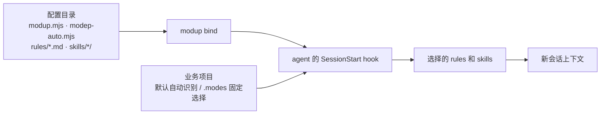

# modup

<p align="center"><b>让工作目录决定 agent 加载哪些 rules 和 skills。</b></p>

借鉴 Emacs modes，把编程、运维、写作等工作方式声明为 mode。rules 和 skills 集中放在自己的配置目录，业务项目默认自动识别，需要固定选择时再添加纯文本 `.modes` 文件。支持 Claude Code、Codex 和 CodeBuddy Code CLI。

## 开始使用

需要 Node.js 20+，运行于 macOS 或 Linux。

```sh
npm install -g modup
```

进入准备用来管理配置的目录，运行：

```sh
modup init
```

modup 只扫描全局已有的 rules 和 skills，让你选择要纳入管理的资源、为它们命名，将规则导入配置目录的 `rules/<name>.md`、技能导入 `skills/<name>/`，并生成 `modup.mjs` 和 `modep-auto.mjs`。确认导入并成功写入配置后，已选的原生 skills 入口会移到配置目录的 `.modup/backups/<批次>/`；`restore.json` 记录原路径和备份路径，可按记录移回。未选资源、rules、evoloop 管理入口和配置真源保留。随后编辑 mode 声明，决定每种工作方式需要哪些资源。

在这个配置目录绑定 agent：

```sh
modup bind --agent claude
```

将 `claude` 换为 `codex` 或 `codebuddy`，即可绑定相应 agent。之后从业务项目启动原生 agent，新会话会自动加载对应的 rules 和 skills。

在业务项目运行 `modup migrate`，可选择并命名当前目录的原生 skills，导入已绑定配置目录的 `skills/`，绑定到当前显式或自动选中的业务 mode（不展开继承 mode），成功后同样备份原入口。`--list` 只读预览；没有当前 mode 时用 `--mode <名称>` 指定一个已有 mode，绑定了不同配置目录时用 `--config <目录>` 指定。同名同内容复用，不同内容需改名。配置更新保留现有 JS，只接受静态 `export default` 对象及显式 skills 数组；动态表达式需先手动整理。

## 配置按工作方式组织

`modup.mjs` 中先声明资源，再把资源名称绑定到 mode。资源路径相对于配置目录；rule 指向 Markdown 文件，skill 指向包含 `SKILL.md` 的目录。

```js
export { default as auto } from './modep-auto.mjs';

export default {
  resources: {
    rules: {
      coding: 'rules/coding.md',
      operations: 'rules/operations.md',
    },
    skills: {
      review: 'skills/review',
    },
  },
  modes: {
    prog: { rules: ['coding'], skills: ['review'] },
    ops: { rules: ['operations'] },
  },
};
```

把示例路径和名称换成初始化时选定的资源。规则正文会注入会话；skill 先提供名称、描述和路径，正文按需读取。

默认无需创建 `.modes`：文件缺失或内容空白时，`modep-auto.mjs` 会根据目录内容自动选择 mode：

```js
export default ({ files, dependencies }) =>
  files.includes('package.json') || dependencies.includes('typescript')
    ? ['prog']
    : [];
```

`auto` 是普通 JS 函数，可以导入自己的模块，也支持异步。它收到 `cwd`、`boundary`、`files` 和 `dependencies`，返回配置中已声明的 mode 名称数组。文件路径与依赖基于工作区根目录收集。配置及 auto 脚本以本机用户权限执行。

需要固定选择时，在业务项目中创建非空 `.modes`；例如以下内容会选择 `prog` 和 `ops`，覆盖自动检测：

```text
prog,ops
```

## 从配置到会话



绑定后，hook 在会话开始时读取配置和工作目录，准备对应的上下文；不需要额外的入口 skill。agent 原有的全局和项目配置仍由它自己加载。

Codex 绑定后还需要在 `/hooks` 中审查并信任 hook。CodeBuddy 的适配对象是 CodeBuddy Code CLI。

需要查看准备注入的内容时，可在配置目录用 `render` 调试，并将 `/path/to/project` 替换为业务项目路径；它不会启动模型：

```sh
modup render --agent claude --cwd /path/to/project
```

移除某个 agent 的绑定：

```sh
modup unbind --agent claude
```
