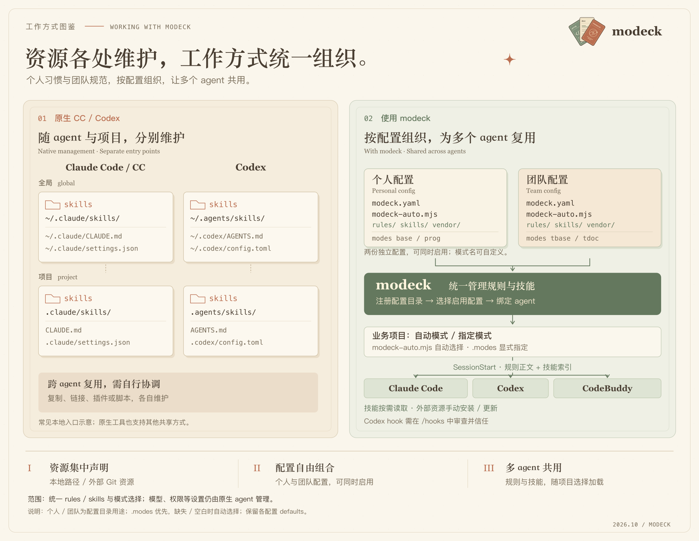

<p align="center">
  
</p>

<p align="center">
  <strong>多 agent 的配置与技能分散、切换项目还要反复整理？modeck 集中管理多套规则、技能和外部资源，并按项目自动组合，在 agent 启动时自动注入上下文。</strong>
</p>

<p align="center">
  <a href="assets/comparison.png"></a>
</p>

## 安装

需要 Node.js 20+ 和你要使用的 agent CLI。通过 npm 全局安装：

```sh
npm install -g modeck
modeck --version
```

## 初始化并启用配置

1. 创建并进入配置目录，导入你选中的规则和技能：

   ```sh
   mkdir agent-config
   cd agent-config
   modeck init
   ```

   按提示选择 agent 和资源。初始化生成 `modeck.yaml` 和 `modeck-auto.mjs`；移动原生入口前展示变更与备份位置，受管或共享入口保留。

2. 注册配置, 支持注册多份配置：

   ```sh
   modeck register
   ```

3. 选择启用的配置和绑定的 agent：

   ```sh
   modeck config
   ```

   modeck 安装 SessionStart hook，保留其他工具的 hook。使用 Codex 时，在 `/hooks` 中审查并信任安装的定义；绑定本身不授予信任。

4. 预览会话上下文：

   ```sh
   cd path-to-target-project
   modeck render
   ```

   输出规则正文和技能索引。之后在该目录启动原生 agent，会话通过 hook 加载相同内容。

## 组合工作模式

在 `modeck.yaml` 中声明资源，再通过资源名称组合 mode。本地资源写相对路径，外部资源写 `(use 仓库地址)/仓库内路径`：

```yaml
resources:
  rules:
    coding: rules/coding.md
  skills:
    review: skills/review
    technical-documentation: (use https://github.com/wondelai/skills.git)/technical-documentation
defaults: [base]
modes:
  base: {}
  prog:
    extends: [base]
    rules: [coding]
    skills: [review]
  doc:
    extends: [base]
    skills: [technical-documentation]
```

示例中的 `coding` 和 `review` 对应配置目录里已有的本地文件或目录；`technical-documentation` 从外部仓库安装。保存配置后，在配置目录运行 `modeck res init`，再在业务项目的 `.modes` 中选择 `prog`、`doc` 或组合使用。

rule 是 Markdown 文件，skill 是包含 `SKILL.md` 的完整目录。`defaults` 始终加载，`extends` 可复用其他 mode；`modes` 可定义多个工作模式，并通过继承组合规则与技能。初始化导入的资源默认归入 `base`；将只用于编程的资源移入 `prog`，才能按需加载。

自动选择脚本 `modeck-auto.mjs` 接收目录、文件和依赖等工作区事实，默认导出函数并返回已声明的 mode 名称。初始化生成的函数返回空数组。

需要固定某个项目的工作模式时，在业务目录创建纯文本 `.modes`，可指定多个 mode：

```text
prog,doc,web
```

多个名称用逗号或换行分隔。非空 `.modes` 中的多个 mode 会组合加载，并保留默认 mode 和继承关系；缺失或空白时使用自动选择。

## 管理外部资源

外部规则和技能都直接声明在 `modeck.yaml` 中，格式为 `资源名称: (use Git仓库地址)/仓库内路径`。rule 指向单个 Markdown 文件，skill 指向包含 `SKILL.md` 的目录。

下面以你自己的资源仓库为例；将 `your-org/agent-resources` 和仓库内路径替换为实际值：

```yaml
resources:
  rules:
    team-guide: (use https://github.com/your-org/agent-resources.git)/rules/team-guide.md
  skills:
    review: (use https://github.com/your-org/agent-resources.git)/skills/review
```

安装外部资源需要本机可用 Git。在配置目录运行：

```sh
modeck res init     # 安装新增资源，按锁恢复缺失内容
modeck res update   # 主动更新到远端默认分支的最新版本
```

`res init` 增量安装：没有锁记录的资源从仓库默认分支获取，已有且完整的资源跳过，缺失资源按 `modeck-lock.json` 中的 commit 和摘要恢复。`res update` 重新获取默认分支并更新锁记录。两个命令都输出逐项状态和数量汇总；本地内容被修改时会停止，避免覆盖。

安装目录按资源名称自动生成，保留规则与技能分类。上例对应：

```text
vendor/
  rules/
    team-guide.md
  skills/
    review/
      SKILL.md
modeck-lock.json
```

`/vendor/` 和 `/.modeck/` 会自动加入 `.gitignore`；`.modeck/` 存放本机状态、暂存和备份。共享 YAML 和根目录 `modeck-lock.json`，其他机器拉取配置后运行 `modeck res init`，即可安装相同的锁定版本。资源地址和路径留在 YAML，安装路径、commit 和摘要由工具维护。

会话启动时只读取并校验这些已安装资源，不自动下载或更新。修改资源来源后需再次运行 `res init`；已有 `.modeck/resources/` 安装会在校验后迁移到 `vendor/`，保留锁定版本，目标重名或本地修改会阻止迁移。移除声明不会删除本地目录。

## 命令介绍

运行 `modeck --help` 查看命令总览，当前输出如下：

```text
Usage: modeck <command> [options]

Commands:
  res <init|update>  Manage external resources
  init                   Initialize configuration
  scan                   Import resources from agent homes
  migrate                Migrate existing project-scope configuration
  resolve                Resolve context
  render                 Render context
  hook                   Handle agent session hooks
  register               Register a configuration
  unregister             Unregister a configuration
  config                 Manage registered configurations

Options:
  -h, --help              Show help
  -v, --version           Show version
```

以下命令中的 `CONFIG_DIR` 是配置目录，`PROJECT_DIR` 是业务项目目录，运行前替换为实际路径。agent 标识为 `claude`、`codex` 或 `codebuddy`。

### 初始化与导入

`init` 创建配置；已有配置后用 `scan` 追加从 agent 用户目录发现的资源。`--list` 只输出发现结果的 JSON，不执行导入；实际导入时按提示选择资源，并在移动原生入口前确认变更和备份位置。

```sh
modeck init # 进入引导流程
modeck init --agent codex --config CONFIG_DIR --list
modeck init --agent codex --config CONFIG_DIR
modeck scan --agent claude --config CONFIG_DIR --list
modeck scan --agent claude --config CONFIG_DIR
```

`modeck init --help` 和 `modeck scan --help` 可查看各自支持的参数。

### 管理多份配置

注册目录后，通过 `config` 统一选择启用的配置和绑定的 agent。新注册的目录默认未启用；所有绑定的 agent 共用选中的配置集合，按注册顺序组合加载。

```sh
modeck register --config CONFIG_DIR
modeck config --list
modeck config --dry-run
modeck config
modeck unregister --config CONFIG_DIR
```

`config --list` 输出已注册目录、启用状态及各 agent 的绑定状态；`config --dry-run` 交互选择后输出变更计划和冲突，不应用变更。`unregister` 只移除注册，不删除配置目录。

需要脚本化管理时，`config --answers FILE` 读取 JSON 文件：`configs` 为要启用的已注册目录绝对路径数组，`agents` 为要绑定的 agent 标识数组。两项都必须提供，空数组表示不启用配置或不绑定 agent。先用 `modeck config --answers FILE --dry-run` 检查计划，再用 `modeck config --answers FILE --expect DIGEST` 应用，其中 `DIGEST` 替换为计划输出的 `planDigest`；计划变化时会拒绝应用。

### 安装与更新资源

`res` 操作指定配置目录中的外部资源；省略 `--config` 时使用当前目录。在多份配置之间切换时建议明确指定目录。

```sh
modeck res init --config CONFIG_DIR
modeck res update --config CONFIG_DIR
modeck res --help
```

`res init` 按声明和 `modeck-lock.json` 同步资源：已有资源校验后跳过，缺失内容按锁定 commit 恢复，新增声明首次安装并加入锁。确实需要升级远端版本时用 `res update`，并审查、共享更新后的锁文件。

### 排查 mode 选择

在业务项目目录运行 `modeck resolve`，输出解析计划的 JSON，包括最终 mode、选中的资源、选择原因和诊断信息。可指定业务目录，或指定单份配置单独排查：

```sh
modeck resolve
modeck resolve --cwd PROJECT_DIR
modeck resolve --config CONFIG_DIR --cwd PROJECT_DIR
```

省略 `--config` 时优先使用注册配置集合；尚未注册时回退到已有绑定，再尝试当前目录的配置。`resolve` 会准备并校验上下文，也会执行配置中的自动选择脚本；缺失外部资源需先运行 `res init`。

### 直接启动会话

`run` 为单次 agent 启动选择 mode、校验资源并注入规则和技能索引，不创建 hook 绑定，也不修改 agent 配置。适合试用一份配置，或在临时环境、CI 中执行一次任务。已经绑定 hook 的日常会话直接启动原生 agent 即可。

`--agent` 必填；`--config` 指定配置目录，省略时使用已注册或已绑定配置，再回退到当前目录。`--cwd` 指定 agent 工作目录，并决定项目事实和 `.modes` 的选择，默认使用当前目录。`--` 后传递受支持的 agent 会话参数或提示词：

```sh
modeck run --agent codex
modeck run --agent claude -- "检查当前项目的代码结构"
modeck run --agent codebuddy -- "检查当前项目的代码结构"
```

需要先安装对应 CLI，并为声明的外部资源执行 `res init`。`run` 默认从 `PATH` 查找 CLI，`--executable` 可指定可执行文件，`--state` 可指定配置目录之外的资源缓存。完整参数见 `modeck run --help`。它继承终端输入输出，并传递 agent 的退出码和终止信号。

上下文在启动时确定，切换 mode 或工作目录后应重新启动。已有 hook 只有在配置、目录和上下文一致时才跳过重复注入，不一致会报错。`run` 只接受实现支持的会话参数，不能任意转发所有原生子命令；账号登录等操作直接运行原生 CLI。`hook` 是绑定后的 SessionStart 内部入口，日常无需手动调用。

## 调整或移除绑定

运行 `modeck config`，取消勾选需要解绑的 agent，或调整启用的配置。移除目录注册使用 `modeck unregister --config CONFIG_DIR`，将 `CONFIG_DIR` 替换为配置目录路径；已绑定的旧式单目录配置需先通过 `modeck config` 更新绑定。

源码升级后重新运行 `modeck config`，更新 hook 使用的运行时副本。

[架构设计](docs/architecture.md) · [参与开发](CONTRIBUTING.md)
