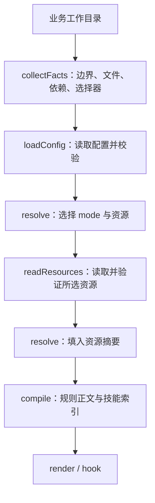

# modeck 架构设计

本文面向维护者和适配器作者，解释配置如何变成会话上下文，以及资源、hook 和绑定的安全边界。**实现现状**以本文链接的源码为准；末节的演进建议不代表已支持的能力。上手步骤见 [README](../README.md)，开发环境与提交检查见 [参与开发](../CONTRIBUTING.md)。

## 设计目标与边界

modeck 把个人配置目录中的 rules 和 skills 按 mode 组合，接入 Claude Code、Codex、CodeBuddy Code CLI、Qwen Code CLI、Qoder CLI、Factory Droid 和 GitHub Copilot CLI。业务目录提供工作区事实及可选 `.modes`，配置目录保存资源与选择逻辑，两者独立。

工具负责选择、校验、编译和接入上下文，不替代 agent 原生指令加载、工具权限或模型服务。它不改写业务项目的 `AGENTS.md` / `CLAUDE.md`，也不提供模型缓存命中保证。

本实现使用 Node.js 22.20.0+、TypeScript 严格模式和 ESM。CLI 支持 macOS / Linux；Git 工作区边界探测和 Git 资源获取依赖本机 Git。协议与共享类型见 [contracts](../src/contracts/types.ts)。

## 模块边界

各目录按以下职责组织：

| 模块 | 职责 | 主要接口与边界 |
| --- | --- | --- |
| [contracts](../src/contracts/index.ts) | 类型、错误、协议、摘要及上限 | `Config`、`ResolvedPlan`、`VerifiedResourceSet`、`RenderedContext`、`BindPlan` |
| [core](../src/core/index.ts) | 配置校验、工作区事实、mode 解析、文本编译 | `collectFacts` / `loadConfig` 执行 I/O；`resolve` / `compile` 为纯函数 |
| [resources](../src/resources/index.ts) | 本地与已安装资源、内容存储、完整性校验 | `readResources` 返回已验证资源；外部资源安装由 CLI 的 `res init/update` 管理 |
| [integration](../src/integration/index.ts) | 准备上下文、hook 协议与绑定 | `prepare`、`encodeHook`、`planBind` / `applyBindPlan` |
| [cli](../src/cli/main.ts) | 参数、交互、配置发现、初始化与迁移 | 文件系统和终端副作用留在命令边界 |
| [schemas](../schemas/modes.schema.json) | 配置与资源 manifest 的数据契约 | schema 校验后继续核对引用、继承图和树摘要 |

这是运行职责分层，不是严格单向的包依赖图：例如 resources 会调用 core 的配置身份复核。改公共契约时，需要同步检查 TypeScript 类型、JSON Schema 和校验逻辑。

## 静态 MCP 配置

静态 MCP 由独立的 `modeck-mcp.json` 管理，不进入 mode 解析、多源组合或 SessionStart 注入。`src/contracts/mcp-static.ts` 定义 v2 契约：portable `servers` 可由适配器编码到不同 agent；`agents.claude.mcpServers` 与 `agents.codex.mcp_servers` 保存各自原生 JSON 定义，同名跨 agent 隔离，同一 agent 内与 portable 同名则拒绝。原生 JSON 值按原样验证和保留，Codex TOML 写入前须通过 parse/stringify 往返检查。portable 的环境引用及传输限制不套用到 native 定义。

`src/mcp/config.ts` 负责 schemaVersion 2 JSON 校验，`src/mcp/manage.ts` 读取唯一中央 JSON 并生成原生导入、状态与应用计划；`src/mcp/native.ts` 处理 agent 原生布局及精确合并，`src/mcp/transaction.ts` 承担文件提交和恢复。`mcp migrate` 从原生配置导入到私有 JSON，不改原生配置字节；即使没有新增 native 定义也会创建 JSON，即使只登记匹配项也会事务收紧权限至 `0600`。`status` 只读。ownership source、pending/committed journal 与 stale lock 必须精确匹配当前 JSON 中央路径；端点身份绑定、漂移拒绝、原子批拒绝及未管理项保留构成写入边界。当前仅管理 Claude user/project 与 Codex 默认 user 配置；CodeBuddy 尚未适配。

## 从工作目录到上下文

`resolve`、`render` 和 `hook` 共用 [prepare](../src/integration/prepare.ts)。它先解析选择，再读取被选资源，最后编译；因此未选中的缺失资源不会阻塞本次会话。`resolve` 命令也执行资源准备与编译，不是只读取配置的静态预览。

主流程如下；图中的第二次解析把已验证资源摘要写入最终计划：

计划保留 `cwd`、边界、选择器路径和选择原因，供诊断使用；稳定正文不插入这些运行诊断。输出协议是 `modeck-context/1`。

### 配置发现与执行

[配置发现](../src/cli/config.ts)依次选择显式 `--config`、注册配置集合、本机已有绑定记录中的配置目录、调用目录内的 YAML 配置。没有注册集合且绑定指向多个不同配置目录时，命令要求显式 `--config`。已有注册或绑定优先于业务目录配置，避免业务仓库自动覆盖已信任的配置入口。

[配置读取](../src/core/config-file.ts)接受 `modeck.yaml` 或 `modeck.yml`，两者同时存在时报错。YAML 声明资源、`defaults` 和 modes；不执行 `modeck.mjs`。可选的 `modeck-auto.mjs` 默认导出自动选择函数，与声明配置分开加载，文件名保留现有拼写。

[自动选择执行器](../src/core/auto.ts)在独立 Worker 中加载 `modeck-auto.mjs`，并记录导入文件摘要，隔离模块缓存。它支持异步函数，传入 `cwd`、`boundary`、`files` 和 `dependencies`。**Worker 不是权限沙箱**：自动选择脚本及其导入模块以本机用户权限执行；超时和摘要校验不能使不可信 JS 安全。配置加载后和资源处理前后会复核 YAML 及脚本来源文件身份。

### 工作区与选择顺序

[事实采集](../src/core/facts.ts)以 Git worktree 根目录为边界；非 Git 目录以调用目录为边界。`.git` 文件形式的 worktree 也由 Git 探测。文件与根目录 `package.json` 中的依赖名在边界范围内收集，按稳定顺序输出；扫描跳过符号链接、`.git`、`node_modules`、构建目录及状态目录，并在超限时报错。

`.modes` 从调用目录向边界查找，最近的文件生效。缺失或空白启用自动选择；非空内容是逗号或换行分隔的 mode ID，关闭 `auto` 选择。空白文件也会终止向父目录查找。它不是 JSON，也没有禁用父 mode 的语法。

[resolver](../src/core/resolve.ts)按以下顺序形成结果：

1. 按声明顺序加入 `defaults`。
2. 若自动选择启用，按 `auto` 返回数组的顺序加入 mode。
3. 按 `.modes` 中的顺序加入显式 mode。
4. 按 `extends` 声明顺序递归展开，父 mode 在子 mode 前，稳定去重。
5. 按 mode 和资源绑定的声明顺序收集 rules、skills，按资源 ID 去重。

非空 `.modes` 只替代自动检测，仍保留 `defaults` 及所选 mode 的继承。未知 mode、循环继承、未知资源或类型不匹配会报错。`auto` 是保留 mode 名称。

## 资源与完整性

[资源仓库](../src/resources/repository.ts)统一处理本地路径和 `(use URL)/path` 资源映射。本地路径相对配置目录；rule 指向 Markdown 文件，skill 指向含 `SKILL.md` 的完整目录。简洁声明直接放入 `resources.rules` 或 `resources.skills`，不需要 `head`、`ref`、`target` 或独立清单。

资源读取与同步行为如下：

| 来源 | `render` / `hook` 等运行期读取 | `res init` | `res update` |
| --- | --- | --- | --- |
| 本地 | 重新快照源文件或目录，发布内容对象 | 无需安装 | 无需安装 |
| `(use URL)/path` | 读取 `vendor/` 的安装内容，复核锁定来源和摘要；缺失时提示 `res init` | 按声明和锁同步：校验已安装项、按锁恢复缺失项、安装新增项 | 获取默认分支并更新安装内容和锁 |

运行期资源层不拉取 Git；自动选择脚本自身仍有联网能力。`res init/update` 处理指定配置目录中的全部外部资源声明，运行期只处理所选资源。

默认状态目录是 `~/.local/share/modeck/v1`，可由 `--state` 或 `MODECK_STATE` 调整，且必须位于配置目录之外。状态目录包含以下内容：

| 路径 | 内容与身份 |
| --- | --- |
| `store/sha256/<treeDigest>/tree/` | 规则标准化为 `content.md`，技能保留完整资源树 |
| `store/sha256/<treeDigest>/manifest.json` | 按路径排序的树条目：文件摘要、字节数和可执行位 |
| `skills/<name>@<digest前缀>/` | 验证后物化的技能短路径，作为索引的 root；前缀从八位开始，碰撞时逐位延长 |

[内容存储](../src/resources/store.ts)先写临时目录，再以 rename 发布只读内容对象。读取时复核 manifest 和整棵树，额外文件、缺失条目、正文或可执行位变化都会影响验证。[树校验](../src/resources/tree.ts)拒绝资源中的符号链接、特殊文件、大小写冲突及部分敏感路径和私钥内容；这些检查不等同于完整的秘密扫描。

[Git 获取](../src/resources/git.ts)读取 commit 的 blob，不运行仓库安装命令，不初始化 submodule，并禁用 Git hooks 和多项隐式配置。Git 树中的 symlink、gitlink 和特殊条目被拒绝。资源内容及 skill 脚本不会在获取过程中执行。

`res init` 从简洁映射生成安装请求，技能放入顶层 `vendor/skills/<id>/`，规则放入 `vendor/rules/<id>.md`。首次安装使用仓库默认分支，根目录 `modeck-lock.json` 保存解析后的 commit、摘要及生成路径；后续 init 跳过完整安装并按锁恢复缺失内容，新增声明只安装新增项。已有 `.modeck/resources/` 安装经来源和内容校验后迁移，保留锁定 commit 和摘要；本地修改或目标重名会阻止迁移，失败时回滚。`res update` 重新获取默认分支并逐项输出进度，最后输出逐项状态和数量汇总。

`vendor/` 存放下载资源，`.modeck/` 保留本机状态、安装互斥、暂存及备份；两者加入配置目录 `.gitignore`，共享 YAML 和根目录 `modeck-lock.json`。运行期验证安装内容与锁记录，不联网；来源声明变化或缓存缺失时需要重新执行 `res init`，本地内容被修改时拒绝覆盖。资源安装在配置身份变化等可捕获错误下回滚目标、锁和忽略文件。没有 `--frozen` 命令；远端是否仍提供锁定 commit 影响缺失资源的恢复，内容摘要也不能证明资源作者可信。

## 编译与按需技能

[编译器](../src/core/compile.ts)检查计划与资源身份一致后，依次输出 `<INSTRUCTIONS>` 规则正文和 `<SKILLS>` 技能索引；没有规则时省略前者。规则正文统一 UTF-8、LF 和末尾换行，不添加资源 ID 注释；技能只提供名称、描述、绝对 `root` 和 `entry`，正文由 agent 在匹配任务后读取，配套 references/assets/scripts 从 root 定位。`render --format json` 也不展示 mode ID；内部计划、资源匹配及摘要继续保留 ID 关联，`resolve` 仍提供诊断计划。

索引不是原生 skill 注册，不保证 agent 必然调用技能。modeck 不自动执行 skill 脚本；脚本执行仍服从 agent 的工具权限。Claude Code、Codex 和 CodeBuddy 按各自原生扫描结果省略同名技能索引，去重依据是名称，不是内容比较。Qwen、Qoder、Factory Droid 和 Copilot CLI 保留完整索引，不做原生同名过滤，避免扫描差异造成漏注入。

`render` 的所有 agent 共用同一正文模板，规则不会按 agent 转换。原生技能过滤因 agent 而异：Claude 扫描当前目录到工作区边界的 `.claude/skills` 及用户配置的 skills，单层读取，缺少名称时使用目录名；Codex 扫描相同目录范围的 `.agents/skills`、用户 `.agents/skills`、Codex 用户配置及 `/etc/codex/skills`，递归寻找含有效名称和描述的技能；CodeBuddy 扫描当前目录 `.codebuddy/skills` 和用户配置的 skills，递归读取并支持以冒号分隔的目录名作为回退。这三者按原生扫描结果省略同名索引。Qwen、Qoder、Factory Droid 与 Copilot CLI 不做同名过滤，始终保留完整技能索引；Qwen 原生扫描规则更复杂，Qoder 的祖先目录与递归扫描边界尚未证实，因此不推断其过滤结果。用户配置位置受对应 agent 的原生配置设置影响。未指定 `--state` 或 `MODECK_STATE` 时，`render` 还会优先使用所选 agent 绑定的状态目录，不同目录会改变索引中的技能绝对路径。配置、工作目录、状态目录及原生技能过滤结果相同时正文相同，但 JSON 中的 `agent` 和包含 agent 的 `selectionDigest` 仍不同。未指定 `--agent` 时交互选择一个 agent，非交互调用必须显式指定。

正文同时受 9,000 字符和 32,768 字节上限约束，超过任一上限会报 `E_CONTEXT_SIZE`，不会静默截断。完整阈值见 [LIMITS](../src/contracts/constants.ts)。

摘要各自表示不同身份：

| 摘要 | 含义 |
| --- | --- |
| `configDigest` | 规范化配置及被追踪的配置来源文件 |
| `resourceDigest` | 本次已验证资源 manifest |
| `selectionDigest` | 协议、agent、有序 modes 与去重后的资源身份 |
| `contentDigest` | 实际输出文本的 UTF-8 字节 |

同一安装、相同输入及原生技能名称集合可得到稳定文本。技能索引包含绝对存储路径，因此不能保证跨机器字节相同；agent 自身指令、工具定义和模型服务也不在这些摘要的控制范围内。

### 决定：不实现 Claude 专属路径延迟注入

modeck 不实现 Claude 专属 `PreToolUse` path-scoped 延迟注入，继续使用跨 agent 的 `SessionStart` 编译正文。[Claude hooks 协议](https://code.claude.com/docs/en/hooks#pretooluse)允许从 `Read|Write|Edit` 的 `tool_input.file_path` 匹配规则并返回 `hookSpecificOutput.additionalContext`，所以最小实现可行；但上下文随工具结果进入下一次模型请求，不能让模型在当前写入或同批并行调用执行前依据新规则重新决策，不能作为写入前的规则执行保证。

其收益主要是减少启动正文；当前编译器直接拼接规则原文，frontmatter 仅作为文本保留，没有规则路径元数据或会话注入状态。完整支持还需定义业务路径相对基准、YAML/glob（含 brace expansion）及符号链接语义，从启动正文移除延迟规则，并扩展绑定所有权与恢复。只监听 Read 会漏掉直接 Write/Edit；Bash 只有命令文本，任意脚本的文件访问无法据此可靠枚举；`@file` 的上下文展开也不能假设会触发 Read hook。按次注入会重复消耗上下文，去重则需隔离主会话和 subagent，处理并发、规则摘要更新、compact/clear/resume/fork 后的失效与重注入；每次工具调用启动进程、重新校验资源或维护可信快照又增加延迟和失败分支。hook 禁用、失败或超时仍可能漏注入。这些成本集中于单一 agent，现阶段不足以支持复刻其原生加载器。

需要路径语义的规则保留在原生项目 `.claude/rules/`，避免同时选入 modeck 导致全量加载或重复；扫描迁移时应保留相应原生入口。[原生 rules 协议](https://code.claude.com/docs/en/memory#path-specific-rules)已覆盖 Read/Write/Edit、部分可识别为读取的 Bash 命令及路径匹配；[subagent](https://code.claude.com/docs/en/sub-agents#what-loads-at-startup)也有自身的按路径加载。规则 frontmatter 中仅 `paths` 被 Claude 解释，`name` 等其他字段被忽略；modeck 不承诺重现原生规则的匹配、加载时序或去重语义。

## Hook 与启动适配

[hook 适配](../src/integration/hooks.ts)按 agent 校验 `SessionStart` 输入，并以各 CLI 原生格式返回上下文。七种适配都使用同步 command hook；hook 启用且成功时，在主会话首轮推理前返回上下文，不承诺屏障覆盖启动阶段的 auxiliary、鉴权或其他网络请求。CodeBuddy 事件缺少 `cwd` 时使用 hook 进程的工作目录。

绑定写入的默认位置如下，路径相对于 `--target-home`，默认是本机 home：

| Agent | Hook 文件 | 接入注意事项 |
| --- | --- | --- |
| Claude Code | `.claude/settings.json` | 合并 `SessionStart` 组；hook 失败不能保证阻止首个模型请求 |
| Codex | `.codex/hooks.json` | 安装不授予信任，需要在 `/hooks` 审阅并信任定义 |
| CodeBuddy Code CLI | `.codebuddy/settings.json` | 使用 CLI hook 协议；加载行为还受其运行时控制 |
| Qwen Code CLI | `.qwen/settings.json` | 使用原生 `SessionStart` command hook |
| Qoder CLI | `.qoder/settings.json` | 使用原生 `SessionStart` command hook |
| Factory Droid | `~/.factory/hooks.json` | 需 CLI 0.196.0+（修复 `SessionStart` 上下文丢弃）；使用原生顶层事件映射；可能遮蔽原有声明的混合配置会被拒绝，须先整合到原生 `hooks.json` |
| GitHub Copilot CLI | `~/.copilot/hooks/modeck.json` | 需 CLI 1.0.89+（1.0.88 已合并 `additionalContext` 修复，本项目保守提高下限）；使用独立配置文件，输出顶层 `additionalContext` |

这些是 modeck 实现的写入位置，不代表所有 agent 自定义配置目录布局都可由绑定命令自动发现。hook 被禁用、策略阻止、未触发、命令失败或超时时，原生会话仍可能继续且缺少 mode 内容，因此不保证 fail-closed。成功输出 hook JSON 也不等同于真实模型已采纳上下文；尚无登录状态下的真实模型请求验证。

## 绑定计划、应用与恢复

[绑定实现](../src/integration/install.ts)把计算计划和写入分开：`planBind` / `planUnbind` 返回 `BindPlan`，`applyBindPlan` 执行变更。CLI 的 `bind` / `unbind` 默认立即应用；`--dry-run` 只展示绑定文件计划，但 `bind` 准备上下文时仍可能物化本地资源缓存。

每个 agent 在目标 home 的 `.modeck/<agent>/` 内记录 `install.json`、安装锁和按摘要定位的 runtime 副本。运行时副本使 hook 不依赖源码目录持续存在；配置目录和 Node 可执行文件仍必须可用。重新构建或升级 modeck 后，需要重新绑定才能更新已安装副本。

应用过程保留以下约束：

1. 计划记录原文件摘要、权限及计划摘要；`--expect` 可要求本次计划与预览摘要相符。
2. 写入前检查目标所有者、权限、父目录与符号链接，拒绝覆盖 evoloop 标记的共享配置。
3. 只合并归 modeck 所有的 hook 组，保留其他设置；所有权记录缺失或已管理内容被修改时拒绝覆盖。
4. 通过安装锁串行化同一 agent 的安装，写入时再次核对文件身份，并逐文件原子替换。
5. 发生可捕获异常时逆序尝试恢复已写文件；无法安全恢复时保留锁，要求人工检查。

这是有校验和回滚的多文件操作，不是跨文件原子事务。进程崩溃后的自动恢复不受支持；多 agent 绑定也不是一个整体事务。解绑只移除已记录的自有内容，资源状态缓存和配置目录保留。

## 初始化、迁移与备份

[init](../src/cli/init.ts)与 [scan](../src/cli/scan.ts)共用全局资源迁移流程：交互选择 agent，再扫描并选择 rules 和 skills。首次初始化默认在调用目录生成 `modeck.yaml`、`modeck-auto.mjs`；已绑定 agent 的后续扫描复用其配置目录，冲突时拒绝合并不同绑定。

导入先复制并校验到 home 下的 `.modeck/rules/`、`.modeck/skills/` 和配置目录的对应资源路径，然后更新 YAML。首次初始化的资源绑定到默认 `base`，后续扫描加入配置的默认 modes；已导入且内容一致的资源不会重复导入。要按工作方式筛选，需要把业务资源从默认 mode 移到对应 mode。

[migrate](../src/cli/migrate.ts)从配置目录以外的业务项目导入原生 skills，绑定到显式指定或选中的业务 mode，不展开继承；不会把仅由 `defaults` 加入的 mode 当作自动迁移目标。[配置编辑器](../src/cli/edit-config.ts)通过 YAML 文档树追加映射和数组并保留注释；迁移前要求展开 YAML aliases，避免修改一个锚点影响其他 mode。

初始化、扫描和项目迁移均提供 `--list` 预览。[备份模块](../src/cli/backup.ts)在复制、配置写入及完整性校验成功后，把符合条件的原生入口移动到配置目录 `.modeck/backups/<批次>/`，并先写 `restore.json` 记录恢复路径。全局导入可备份 rules 和 skills，项目迁移只处理 skills；受管内容、外部所有者及被保留入口引用的共享来源会保留。备份不是删除；没有独立 restore CLI，恢复需按记录核对并移回，不能覆盖已有入口。

## 演进建议与验收边界

以下为建议，尚未作为本文档任务的功能实现：

| 建议 | 解决的问题 | 实施时保留的边界 |
| --- | --- | --- |
| 独立的严格复用模式 | 缺少锁定内容时禁止获取的额外约束 | 沿用根目录资源锁，不把绝对 home 路径写进共享身份 |
| 安装中断恢复协议 | 崩溃后只能检查残留锁 | 不自动覆盖已被外部修改的文件 |
| Agent 兼容性验收矩阵 | hook 协议输出与模型实际采纳之间的差距 | 记录 CLI 版本、信任状态和实测范围 |
| 为自动选择脚本设计受限执行接口 | 自动选择 JS 的本机权限范围较大 | YAML 与脚本已分离；Worker 隔离仍不能包装成权限沙箱 |

维护时先运行 `npm run typecheck` 和 `npm run build`，再用隔离配置、状态与 home 核查 mode 选择、资源变化、hook JSON、绑定预览和对称解绑。仓库没有 `npm test` 脚本；构建通过不构成真实模型调用、跨机器复现或缓存命中的证明。

`design/` 保存早期设计和验收记录，其中 `.mode`、JSON / JS 配置、mode priority、共享锁文件及首版适配范围属于历史方案。修改实现时，以源码和本说明为核对入口，不把历史提案当成命令参考。
