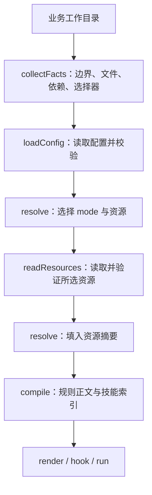

# modeck 架构设计

本文面向维护者和适配器作者，解释配置如何变成会话上下文，以及资源、hook 和绑定的安全边界。**实现现状**以本文链接的源码为准；末节的演进建议不代表已支持的能力。上手步骤见 [README](../README.md)，开发环境与提交检查见 [参与开发](../CONTRIBUTING.md)。

## 设计目标与边界

modeck 把个人配置目录中的 rules 和 skills 按 mode 组合，接入 Claude Code、Codex 和 CodeBuddy Code CLI。业务目录提供工作区事实及可选 `.modes`，配置目录保存资源与选择逻辑，两者独立。

工具负责选择、校验、编译和接入上下文，不替代 agent 原生指令加载、工具权限或模型服务。它不改写业务项目的 `AGENTS.md` / `CLAUDE.md`，也不提供模型缓存命中保证。

本实现使用 Node.js 20+、TypeScript 严格模式和 ESM。CLI 支持 macOS / Linux；Git 工作区边界探测和 Git 资源获取依赖本机 Git。协议与共享类型见 [contracts](../src/contracts/types.ts)。

## 模块边界

各目录按以下职责组织：

| 模块 | 职责 | 主要接口与边界 |
| --- | --- | --- |
| [contracts](../src/contracts/index.ts) | 类型、错误、协议、摘要及上限 | `Config`、`ResolvedPlan`、`VerifiedResourceSet`、`RenderedContext`、`BindPlan` |
| [core](../src/core/index.ts) | 配置校验、工作区事实、mode 解析、文本编译 | `collectFacts` / `loadConfig` 执行 I/O；`resolve` / `compile` 为纯函数 |
| [resources](../src/resources/index.ts) | 本地与 Git 资源、内容存储、完整性校验 | `readResources` / `syncResources` 返回已验证资源，隐藏下载与存储细节 |
| [integration](../src/integration/index.ts) | 准备上下文、hook 协议、绑定与进程启动 | `prepare`、`encodeHook`、`planBind` / `applyBindPlan`、`runAgent` |
| [cli](../src/cli/main.ts) | 参数、交互、配置发现、初始化与迁移 | 文件系统和终端副作用留在命令边界 |
| [schemas](../schemas/modes.schema.json) | 配置与资源 manifest 的数据契约 | schema 校验后继续核对引用、继承图和树摘要 |

这是运行职责分层，不是严格单向的包依赖图：例如 resources 会调用 core 的配置身份复核。改公共契约时，需要同步检查 TypeScript 类型、JSON Schema 和校验逻辑。

## 从工作目录到上下文

`resolve`、`render`、`hook` 和 `run` 共用 [prepare](../src/integration/prepare.ts)。它先解析选择，再读取被选资源，最后编译；因此未选中的缺失资源不会阻塞本次会话。`resolve` 命令也执行资源准备与编译，不是只读取配置的静态预览。

主流程如下；图中的第二次解析把已验证资源摘要写入最终计划：

计划保留 `cwd`、边界、选择器路径和选择原因，供诊断使用；稳定正文不插入这些运行诊断。输出协议是 `modeck-context/1`。

### 配置发现与执行

[配置发现](../src/cli/config.ts)依次选择显式 `--config`、本机已有绑定记录中的配置目录、调用目录内的 YAML 配置。绑定指向多个不同配置目录时，命令要求显式 `--config`。已有绑定优先于业务目录配置，避免业务仓库自动覆盖已信任的配置入口。

[配置读取](../src/core/config-file.ts)接受 `modeck.yaml` 或 `modeck.yml`，两者同时存在时报错。YAML 声明资源、`defaults` 和 modes；不执行 `modeck.mjs`。可选的 `modeck-auto.mjs` 默认导出自动选择函数，与声明配置分开加载，文件名保留现有拼写。

[自动选择执行器](../src/core/auto.ts)在独立 Worker 中加载 `modeck-auto.mjs`，并记录导入文件摘要，隔离模块缓存。它支持异步函数，传入 `cwd`、`boundary`、`files` 和 `dependencies`。**Worker 不是权限沙箱**：自动选择脚本及其导入模块以本机用户权限执行；超时和摘要校验不能使不可信 JS 安全。配置加载后和资源处理前后会复核 YAML 及脚本来源文件身份。

### 工作区与选择顺序

[事实采集](../src/core/facts.ts)以 Git worktree 根目录为边界；非 Git 目录以调用目录为边界。`.git` 文件形式的 worktree 也由 Git 探测。文件与根目录 `package.json` 中的依赖名在边界范围内收集，按稳定顺序输出；扫描跳过符号链接、`.git`、`node_modules`、构建目录及状态目录，并在超限时报错。

`.modes` 从调用目录向边界查找，最近的文件生效。缺失或空白启用自动选择；非空内容是逗号或换行分隔的 mode ID，关闭 `auto` 选择。空白文件也会终止向父目录查找。它不是 JSON，也没有禁用父 mode 的语法。

[resolver](../src/core/resolve.ts)按以下顺序形成结果：

1. 按声明顺序加入 `defaults`。
2. 若自动选择启用，按 `auto` 返回数组的顺序加入 mode。
3. 按 `.modes` 中的顺序加入显式 mode。
4. 按 `extends` 声明顺序递归展开，父 mode 在子 mode 前，稳定去重。
5. 按 mode 和资源绑定的声明顺序收集 rules、skills，按资源 ID 去重。

非空 `.modes` 只替代自动检测，仍保留 `defaults` 及所选 mode 的继承。未知 mode、循环继承、未知资源或类型不匹配会报错。`auto` 是保留 mode 名称。

## 资源与完整性

[资源仓库](../src/resources/repository.ts)统一处理本地路径和 `{ type: 'git', url, ref, path }` 描述。本地路径相对配置目录；rule 指向 Markdown 文件，skill 指向含 `SKILL.md` 的完整目录。初始化导入的资源也采用这一模型。

资源读取与同步行为如下：

| 来源 | `render` / `hook` 等运行期读取 | `sync` | `sync --update` |
| --- | --- | --- | --- |
| 本地 | 重新快照源文件或目录，发布内容对象 | 同样重新快照 | 同样重新快照 |
| Git | 读取已有缓存，未缓存时报错 | 复用缓存；缺缓存时获取 | 重新解析 ref 并获取 |

运行期资源层不拉取 Git；自动选择脚本自身仍有联网能力。`sync` 默认处理全部声明资源，运行期只处理所选资源。

默认状态目录是 `~/.local/share/modeck/v1`，可由 `--state` 或 `MODECK_STATE` 调整，且必须位于配置目录之外。状态目录包含以下内容：

| 路径 | 内容与身份 |
| --- | --- |
| `store/sha256/<treeDigest>/tree/` | 规则标准化为 `content.md`，技能保留完整资源树 |
| `store/sha256/<treeDigest>/manifest.json` | 按路径排序的树条目：文件摘要、字节数和可执行位 |
| `skills/<name>@<digest前缀>/` | 验证后物化的技能短路径，作为索引的 root；前缀从八位开始，碰撞时逐位延长 |
| `git/<descriptorDigest>.json` | Git 来源、解析后的 commit 与资源树信息；缓存键包含配置根目录、ID 和来源描述 |
| `.work/` | Git 获取的临时目录 |

[内容存储](../src/resources/store.ts)先写临时目录，再以 rename 发布只读内容对象。读取时复核 manifest 和整棵树，额外文件、缺失条目、正文或可执行位变化都会影响验证。[树校验](../src/resources/tree.ts)拒绝资源中的符号链接、特殊文件、大小写冲突及部分敏感路径和私钥内容；这些检查不等同于完整的秘密扫描。

[Git 获取](../src/resources/git.ts)读取 commit 的 blob，不运行仓库安装命令，不初始化 submodule，并禁用 Git hooks 和多项隐式配置。Git 树中的 symlink、gitlink 和特殊条目被拒绝。资源内容及 skill 脚本不会在获取过程中执行。

实现不写共享锁文件，也没有 `--frozen` 命令。Git 缓存保存解析结果，但不同机器独立同步同一可变 ref 时仍可能得到不同 commit。需要固定来源时，在配置中使用完整 commit；远端是否仍提供该 commit 也影响获取。内容摘要用于发现变化，不能证明资源作者可信。

## 编译与按需技能

[编译器](../src/core/compile.ts)检查计划与资源身份一致后，按协议头、规则正文、技能索引排列文本。规则正文统一 UTF-8、LF 和末尾换行；技能只提供 ID、名称、描述、绝对 `root` 和 `entry`，正文由 agent 在匹配任务后读取，配套 references/assets/scripts 从 root 定位。

索引不是原生 skill 注册，不保证 agent 必然调用技能。modeck 不自动执行 skill 脚本；脚本执行仍服从 agent 的工具权限。[原生技能扫描](../src/integration/native-skills.ts)按目标 agent 的扫描规则收集名称，编译时跳过同名技能索引以减少重复；去重依据是名称，不是内容比较。

正文同时受 9,000 字符和 32,768 字节上限约束，超过任一上限会报 `E_CONTEXT_SIZE`，不会静默截断。完整阈值见 [LIMITS](../src/contracts/constants.ts)。

摘要各自表示不同身份：

| 摘要 | 含义 |
| --- | --- |
| `configDigest` | 规范化配置及被追踪的配置来源文件 |
| `resourceDigest` | 本次已验证资源 manifest |
| `selectionDigest` | 协议、agent、有序 modes 与去重后的资源身份 |
| `contentDigest` | 实际输出文本的 UTF-8 字节 |

同一安装、相同输入及原生技能名称集合可得到稳定文本。技能索引包含绝对存储路径，因此不能保证跨机器字节相同；agent 自身指令、工具定义和模型服务也不在这些摘要的控制范围内。

## Hook 与启动适配

[hook 适配](../src/integration/hooks.ts)校验 `SessionStart` 的 JSON stdin，通过 `hookSpecificOutput.additionalContext` 返回上下文。接受的 source 包括 `startup`、`resume`、`clear`、`compact` 和 `fork`。CodeBuddy 事件缺少 `cwd` 时使用 hook 进程的工作目录。

绑定写入的默认位置如下，路径相对于 `--target-home`，默认是本机 home：

| Agent | Hook 文件 | 接入注意事项 |
| --- | --- | --- |
| Claude Code | `.claude/settings.json` | 合并 `SessionStart` 组；hook 失败不能保证阻止首个模型请求 |
| Codex | `.codex/hooks.json` | 安装不授予信任，需要在 `/hooks` 审阅并信任定义 |
| CodeBuddy Code CLI | `.codebuddy/settings.json` | 使用 CLI hook 协议；加载行为还受其运行时控制 |

这些是 modeck 实现的写入位置，不代表所有 agent 自定义配置目录布局都可由绑定命令自动发现。成功输出 hook JSON 也不等同于真实模型已采纳上下文。

[run 包装器](../src/integration/run.ts)是另一个启动入口：Claude / CodeBuddy 使用追加 system prompt 参数；Codex 读取有效配置、合并既有 `developer_instructions`，并在启动前复核配置快照。它以 argv 数组和 `shell: false` 启动子进程，继承 stdio、传递退出码及终止信号；仅接受已知参数和受支持子命令，冲突时报错。

包装器设置 `MODECK_RUN_V1` 标记，包含 agent、目录、配置、状态和正文摘要及父进程 PID。hook 发现有效且一致的标记时不重复注入；不一致、过期或嵌套包装器均报错。

## 绑定计划、应用与恢复

[绑定实现](../src/integration/install.ts)把计算计划和写入分开：`planBind` / `planUnbind` 返回 `BindPlan`，`applyBindPlan` 执行变更。CLI 的 `bind` / `unbind` 默认立即应用；`--dry-run` 只展示绑定文件计划，但 `bind` 准备上下文时仍可能物化本地资源缓存。

每个 agent 在目标 home 的 `.modeck/<agent>/` 内记录 `install.json`、安装锁和按摘要定位的 runtime 副本。运行时副本使 hook 不依赖源码目录持续存在；配置目录和 Node 可执行文件仍必须可用。重新构建或升级 modeck 后，需要重新绑定才能更新已安装副本。

应用过程保留以下约束：

1. 计划记录原文件摘要、权限及计划摘要；`--expect` 可要求本次计划与预览摘要相符。
2. 写入前检查目标所有者、权限、父目录与符号链接，拒绝覆盖 evoloop 标记的共享配置。
3. 只合并归 modeck 所有的 hook 组，保留其他设置；所有权记录缺失或已管理内容被修改时拒绝覆盖。
4. 通过安装锁串行化同一 agent 的安装，写入时再次核对文件身份，并逐文件原子替换。
5. 发生可捕获异常时逆序尝试恢复已写文件；无法安全恢复时保留锁，要求人工检查。

这是有校验和回滚的多文件操作，不是跨文件原子事务。进程崩溃后的自动恢复不受支持；多 agent 绑定也不是一个整体事务。解绑只移除已记录的自有内容，资源状态缓存和配置目录保留。

## 初始化、迁移与备份

[init](../src/cli/init.ts)与 [scan](../src/cli/scan.ts)共用全局资源迁移流程：交互选择 agent，再扫描并选择 rules 和 skills。首次初始化默认在调用目录生成 `modeck.yaml`、`modeck-auto.mjs`；已绑定 agent 的后续扫描复用其配置目录，冲突时拒绝合并不同绑定。

导入先复制并校验到 home 下的 `.modeck/rules/`、`.modeck/skills/` 和配置目录的对应资源路径，然后更新 YAML。首次初始化的资源绑定到默认 `base`，后续扫描加入配置的默认 modes；已导入且内容一致的资源不会重复导入。要按工作方式筛选，需要把业务资源从默认 mode 移到对应 mode。

[migrate](../src/cli/migrate.ts)从配置目录以外的业务项目导入原生 skills，绑定到显式指定或选中的业务 mode，不展开继承；不会把仅由 `defaults` 加入的 mode 当作自动迁移目标。[配置编辑器](../src/cli/edit-config.ts)通过 YAML 文档树追加映射和数组并保留注释；迁移前要求展开 YAML aliases，避免修改一个锚点影响其他 mode。

初始化、扫描和项目迁移均提供 `--list` 预览。[备份模块](../src/cli/backup.ts)在复制、配置写入及完整性校验成功后，把符合条件的原生入口移动到配置目录 `.modeck/backups/<批次>/`，并先写 `restore.json` 记录恢复路径。全局导入可备份 rules 和 skills，项目迁移只处理 skills；受管内容、外部所有者及被保留入口引用的共享来源会保留。备份不是删除；没有独立 restore CLI，恢复需按记录核对并移回，不能覆盖已有入口。

## 演进建议与验收边界

以下为建议，尚未作为本文档任务的功能实现：

| 建议 | 解决的问题 | 实施时保留的边界 |
| --- | --- | --- |
| 可分享的资源锁与严格复用模式 | 可变 Git ref 的跨机器版本漂移 | 与本机缓存分离，不把绝对 home 路径写进共享身份 |
| 安装中断恢复协议 | 崩溃后只能检查残留锁 | 不自动覆盖已被外部修改的文件 |
| Agent 兼容性验收矩阵 | hook 协议输出与模型实际采纳之间的差距 | 记录 CLI 版本、信任状态和实测范围 |
| 为自动选择脚本设计受限执行接口 | 自动选择 JS 的本机权限范围较大 | YAML 与脚本已分离；Worker 隔离仍不能包装成权限沙箱 |

维护时先运行 `npm run typecheck` 和 `npm run build`，再用隔离配置、状态与 home 核查 mode 选择、资源变化、hook JSON、绑定预览和对称解绑。仓库没有 `npm test` 脚本；构建通过不构成真实模型调用、跨机器复现或缓存命中的证明。

`design/` 保存早期设计和验收记录，其中 `.mode`、JSON / JS 配置、mode priority、共享锁文件及首版适配范围属于历史方案。修改实现时，以源码和本说明为核对入口，不把历史提案当成命令参考。
